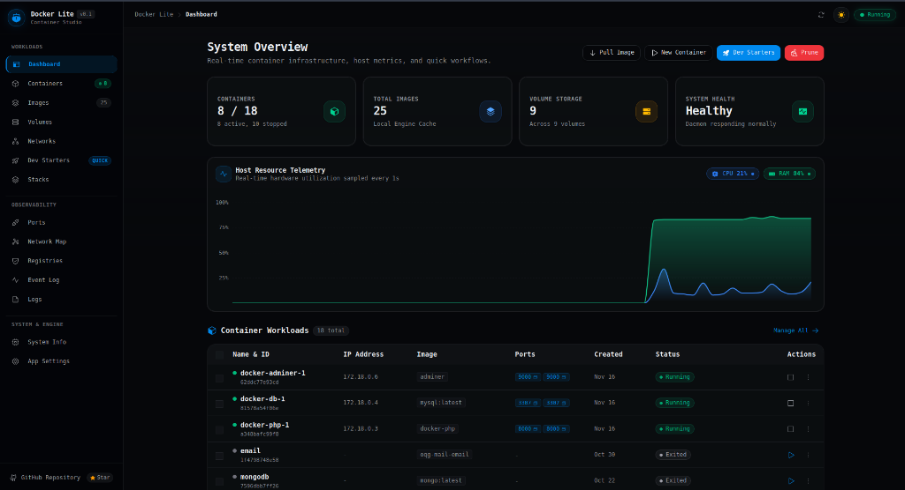
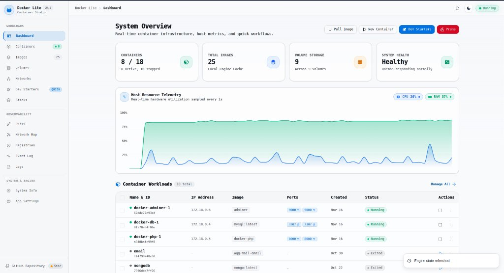
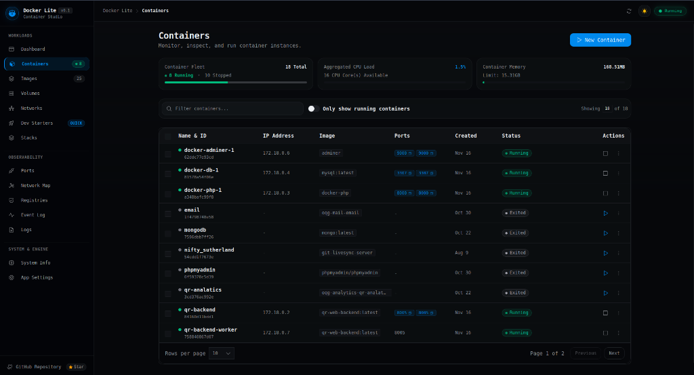
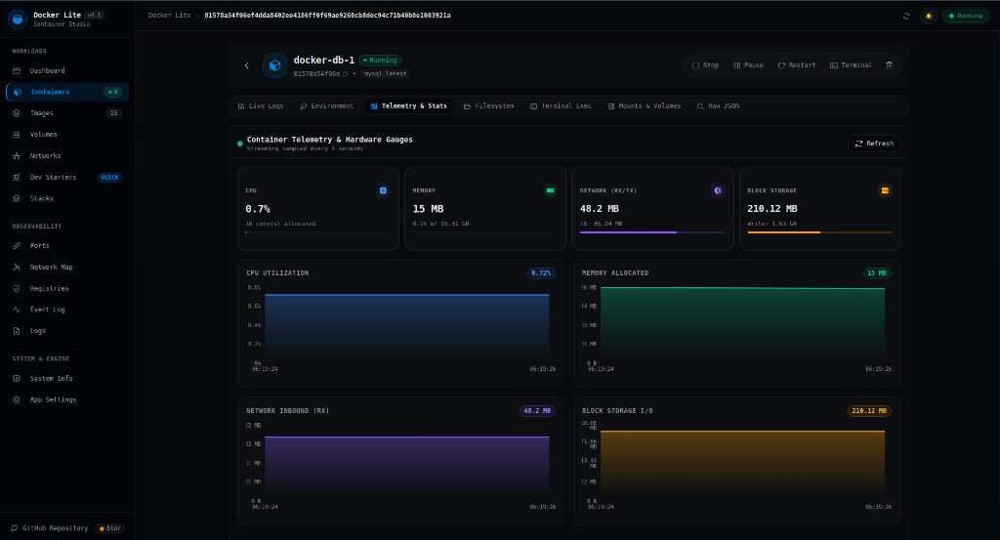

<div align="center">
  <h1>🐳 Docker Lite</h1>
  <p><strong>A lightning-fast, ultra-lightweight Docker desktop client and container studio built with Tauri v2, Rust, and React 19.</strong></p>

  <p>
    <a href="https://github.com/ZerfyT/docker-hub-lite/releases"></a>
    
    
    
    
    
    
  </p>
</div>

---

## 🌟 Why Docker Lite?

Standard container desktop clients (like Docker Desktop) are notorious for being resource-intensive—often requiring dedicated virtual machines, consuming **1 GB to 3 GB+ of RAM** at idle, and suffering from slow cold starts.

**Docker Lite** is built from the ground up to solve this problem. Built on **Tauri v2** and compiled **Rust**, Docker Lite connects directly to your native local Docker socket with zero intermediate virtualization layers. It launches in less than half a second and idles at only **30 MB to 80 MB of RAM**, giving you a responsive, visual container studio without taxing your machine.

---

## 📸 Visual Showcase

### 1. System Overview Dashboard (Dark & Light Modes)
Real-time host CPU & RAM hardware telemetry sampled continuously every 1 second, paired with quick workflow triggers, engine health indicators, and container workloads.

| Dark Theme | Light Theme |
| :---: | :---: |
|  |  |

---

### 2. Container Fleet Management
Monitor active and stopped containers with instant fleet metrics, aggregated CPU loads, memory quotas, live port badges, search filtering, and one-click container actions.



---

### 3. Deep Container Diagnostics & Hardware Gauges
Comprehensive container inspection with 4 real-time telemetry charts (CPU utilization, Memory allocation, Network RX/TX, and Block Storage I/O), live log streaming, interactive file tree exploration, and container terminal exec.



---

## ⚖️ Docker Lite vs. Standard Docker Desktop

| Feature / Metric | 🐳 Docker Lite | 🐋 Standard Docker Desktop |
| :--- | :--- | :--- |
| **Idle Memory Footprint** | **~30 MB – 80 MB RAM** (ultra-light native webview + Rust) | **1.2 GB – 3.5 GB+ RAM** (Electron + Chromium + VM processes) |
| **Startup Speed** | **< 0.5 seconds** (instant native launch) | **15 – 45 seconds** (slow VM boot & Electron init) |
| **Binary / Installer Size** | **~15 MB – 30 MB** | **600 MB – 1.2 GB** |
| **Core Architecture** | **Tauri v2 + Rust (Bollard Async API Client)** | **Electron + Node.js + Embedded Hypervisor VM** |
| **Daemon Connection** | **Direct native socket / named pipe** (`/var/run/docker.sock`) | Virtualized Linux VM layer (`ext4.vhdx`, QEMU / Hyper-V / WSL2) |
| **Licensing & Cost** | **100% Free & Open Source (MIT)** | **Paid subscription required** for enterprise and large teams |
| **Developer Starters Studio** | **Built-in 1-Click Stacks** (Postgres, Redis, Mongo, RabbitMQ, Mailpit, Nginx) | Manual command-line execution or compose files only |
| **Image Tag Suggestions** | **Online Docker Hub auto-completion** & live tag lookups | Basic search redirecting to Docker Hub web browser |
| **Targeted Storage Cleanup** | **Granular Prune Studio** with safety confirmation dialogs | Basic blanket prune commands |
| **Interactive Network Topology** | **Built-in visual node map** (XYFlow graph) | Not available natively without extensions |
| **Host Resource Telemetry** | **1-second persistent hardware streaming** (CPU & RAM graphs) | Basic stats or high CPU overhead polling |
| **Theme & Typography** | **OKLCH-calibrated Light & Dark modes** (high-contrast, glare-free) | Standard dark/light mode |

---

## 🚀 Complete Feature Catalog

### 📊 1. System Overview Dashboard
- **Continuous Host Telemetry:** Live hardware area charts updating every 1 second without full-page re-renders.
- **Resource Summary Cards:** Active and total container counts, local image cache, volume storage counts, and daemon response health.
- **Quick Action Bar:** Direct triggers for Image Pulling, Container Creation, Developer Starters, and System Prune.
- **Live Container Workloads:** Overview table with real-time status indicators, IP addresses, image tags, and quick-action triggers.

### 📦 2. Container Fleet Management
- **Fleet Statistics:** Visual distribution progress bars showing active vs. stopped containers, aggregated CPU load across all host cores, and total container memory consumption.
- **Instant Search & Filter:** Real-time name and ID filtering with an instant "Only show running containers" toggle.
- **Lifecycle Control:** Start, stop, restart, pause, unpause, kill, commit, and delete containers directly from the list.
- **Direct Terminal Access:** One-click shortcut to launch an interactive terminal inside any running container.

### 🔬 3. Deep Container Diagnostics Studio (7 Focused Tabs)
- **Live Streaming Logs:** Real-time log streaming with timestamps, auto-scroll toggle, search filter, one-click copy, and memory-safe 1,000-line buffer.
- **Environment Variables:** Structured inspection of all runtime environment variables with search and key-value copy.
- **Telemetry & Hardware Gauges:** Dedicated real-time area charts for:
  - *CPU Utilization %* (sampled across allocated cores)
  - *Memory Allocated* (real-time MB usage & percentage of host RAM)
  - *Network RX/TX* (inbound and outbound bandwidth utilization)
  - *Block Storage I/O* (read and write throughput metrics)
- **Filesystem Explorer:** Directory navigation and file browsing within the container filesystem.
- **Terminal Exec:** Embedded interactive command runner with configurable shell (`/bin/sh`, `/bin/bash`, `powershell`).
- **Mounts & Volumes:** Visual breakdown of bind mounts, volumes, read/write permissions, and destination paths.
- **Raw JSON:** Complete container inspect payload viewer with formatted syntax highlighting and clipboard export.

### 🖼️ 4. Image Cache & Smart Puller
- **Smart Online Puller:** Real-time Docker Hub search with tag auto-completion, official image indicators, and online tag suggestions.
- **Layer-by-Layer Progress:** Visual multi-stage download and extraction progress bars during image pulls.
- **Image Cache Management:** Inspect image sizes, created dates, virtual tags, and layer counts.
- **Batch Deletion & Safety Dialogs:** Multi-select images for batch deletion with explicit confirmation to prevent accidental data loss.

### 💾 5. Volumes Studio
- **Volume Inspection:** Comprehensive list of local Docker volumes with driver information, mount points, and created timestamps.
- **Disk Usage Calculations:** Accurately calculates reclaimed and active disk space via `docker system df`.
- **Volume Creation & Backup:** One-click volume creation modal and volume backup/export utilities.
- **Targeted Volume Deletion:** Confirmation dialogs preventing deletion of volumes currently in use by active containers.

### 🌐 6. Networks Studio & Interactive Topology
- **Network Management:** Inspect bridge, host, macvlan, overlay, and custom user-defined networks.
- **Connected Containers View:** See which containers are attached to specific network interfaces and subnets.
- **Interactive Visual Topology:** Visual node-link diagram powered by `@xyflow/react` showing network gateways and interconnected container nodes (code-split and lazy-loaded to preserve memory).

### 🔌 7. Port Mapping Matrix
- Global table indexing all exposed and mapped container ports (`Host Port -> Container Port`) across the system.
- Direct clickable links to open container endpoints in your default browser (e.g., `http://127.0.0.1:8080`).

### 📑 8. Docker Compose & Stacks
- Automatically groups and visualizes multi-container stacks defined by Docker Compose.
- Group-level controls to start, stop, restart, or inspect entire service stacks simultaneously.

### ⚡ 9. Developer Starters Studio
Pre-configured 1-click launch templates with sensible development defaults, volume persistence, and port mappings:
- **PostgreSQL 16** (`postgres:16-alpine` on port `5432:5432`)
- **Redis 7** (`redis:7-alpine` on port `6379:6379`)
- **MongoDB 7** (`mongo:latest` on port `27017:27017`)
- **MySQL 8** (`mysql:8.0` on port `3306:3306`)
- **RabbitMQ + Management** (`rabbitmq:3-management-alpine` on ports `5672:5672`, `15672:15672`)
- **Mailpit Local SMTP** (`axllent/mailpit` on ports `1025:1025`, `8025:8025`)
- **Nginx Web Server** (`nginx:alpine` on port `8080:80`)

### 📡 10. Observability: Unified Logs & Live Event Stream
- **Unified Log Viewer:** Centralized console to switch between container logs quickly.
- **Real-Time Engine Event Stream:** Live event listener capturing `docker-event` streams (container die, start, create, destroy, volume attach) with pause/resume controls and event buffer clearing.

### 🧹 11. Targeted Storage Cleanup Studio
Safe, granular storage reclamation studio with dedicated confirmation alerts:
- **Clean Images:** Remove untagged and dangling images.
- **Clean Volumes:** Delete unused anonymous and named volumes.
- **Clean Build Cache:** Flush intermediate build stages and cache layers.
- **Clean Stopped Containers:** Remove all exited or created containers.
- **Clean Unused Networks:** Remove inactive custom bridge networks.
- **System Prune:** Complete engine cleanup with reclaimable disk space projections.

### ⚙️ 12. Engine Settings & Diagnostic Help
- **Host & Daemon Diagnostics:** Kernel version, operating system, server version, CPU count, total RAM, and storage drivers.
- **Direct `daemon.json` Editor:** View configuration in-app or launch your system default editor with one click.
- **Customizable Preferences:** Background polling intervals, telemetry stream toggle, destructive action confirmations, and default terminal shell selection.
- **Integrated Help & Info:** Quick reference guide, keyboard shortcuts, and troubleshooting common Docker daemon socket connection errors.

---

## 🛠️ Architecture & Tech Stack

```
┌─────────────────────────────────────────────────────────────┐
│                 React 19 Frontend (Vite)                    │
│   Tailwind CSS v4 • Radix UI • Phosphor Icons • Recharts   │
│         Zustand Slices (Granular Selector Subscriptions)    │
└──────────────────────────────┬──────────────────────────────┘
                               │ Tauri IPC / Binary Events
┌──────────────────────────────┴──────────────────────────────┐
│                    Tauri v2 (Rust Backend)                  │
│       Tokio Async • Bollard (Docker Engine API Client)      │
│     Targeted Sysinfo Metrics • Memory Release Profile       │
└──────────────────────────────┬──────────────────────────────┘
                               │ Local Unix Socket / Named Pipe
┌──────────────────────────────┴──────────────────────────────┐
│                    Docker Engine / Daemon                   │
└─────────────────────────────────────────────────────────────┘
```

### Frontend
- **Framework:** [React 19](https://react.dev/) + [TypeScript](https://www.typescriptlang.org/)
- **Bundler:** [Vite](https://vitejs.dev/) with Rollup chunk splitting (`vendor-charts`, `vendor-flow`, `vendor-icons`)
- **Styling:** [Tailwind CSS v4](https://tailwindcss.com/) with OKLCH dynamic color spaces
- **Components:** [Radix UI](https://www.radix-ui.com/) + [shadcn/ui](https://ui.shadcn.com/)
- **Icons:** [Phosphor Icons](https://phosphoricons.com/)
- **Visuals:** [Recharts](https://recharts.org/) & [@xyflow/react](https://reactflow.dev/) (lazy-loaded on demand)
- **State Management:** [Zustand](https://zustand-demo.pmnd.rs/) with scoped selector subscriptions

### Backend
- **Framework:** [Tauri v2](https://v2.tauri.app/)
- **Language:** [Rust (Edition 2021)](https://www.rust-lang.org/)
- **Docker Client:** [Bollard](https://github.com/fussybeaver/bollard) (Async Docker Engine API)
- **Async Runtime:** [Tokio](https://tokio.rs/)
- **Host Metrics:** [Sysinfo](https://github.com/GuillaumeGomez/sysinfo) (selective CPU & RAM refresh without process table allocations)

---

## 💻 Supported Operating Systems

| Platform | Supported Formats | Minimum Requirement |
| :--- | :--- | :--- |
| **Linux (Ubuntu, Debian, Fedora, Arch)** | `.snap` (Ubuntu Store), `.deb`, `.AppImage` | WebKit2GTK 4.1+ |
| **macOS (Apple Silicon & Intel Universal)** | `.dmg`, `.app` | macOS 10.15+ (Catalina) |
| **Windows** | `.exe` (NSIS Installer) | Windows 10/11 (WebView2) |

---

## 🛍️ Ubuntu Store & Linux Installation

Docker Lite supports both **Snap** (Ubuntu Store / App Center) and native **Debian (`.deb`)** packages. For detailed instructions on publishing to the Ubuntu Store, see the [Ubuntu Store Publishing Guide](docs/UBUNTU_STORE_PUBLISHING.md).

### Option 1: Install from the Ubuntu Snap Store
```bash
# Install Docker Lite
sudo snap install docker-lite

# Connect the Docker daemon socket interface
sudo snap connect docker-lite:docker
```

### Option 2: Install via Debian Package (`.deb`)
Download the `.deb` file from the [latest release](https://github.com/ZerfyT/docker-hub-lite/releases), then install:
```bash
sudo apt install ./docker-lite_0.2.2_amd64.deb
```
*(Or double-click the `.deb` file to open and install via the native **Ubuntu App Center** with full AppStream metadata and screenshots).*

---

## 🚀 Getting Started

### Prerequisites

1. **Docker Engine**: Docker daemon must be running and accessible:
   ```bash
   docker info
   ```
   *(On Linux, ensure your user is added to the `docker` group: `sudo usermod -aG docker $USER`).*
2. **Node / Bun**: [Bun](https://bun.sh/) (recommended) or Node.js 18+
3. **Rust Toolchain**: [Rust & Cargo](https://www.rust-lang.org/tools/install) (stable)
4. **Tauri Prerequisites**: Refer to [Tauri v2 Prerequisites](https://v2.tauri.app/start/prerequisites/) for your OS (e.g., `libwebkit2gtk-4.1-dev` on Linux).

### Development Setup

1. **Clone the repository:**
   ```bash
   git clone https://github.com/ZerfyT/docker-hub-lite.git
   cd docker-hub-lite
   ```

2. **Install frontend dependencies:**
   ```bash
   bun install
   ```

3. **Start in development mode:**
   ```bash
   bun run tauri dev
   ```

### Production Build

To build native release binaries for your current operating system:
```bash
bun run tauri build
```

The resulting packages will be generated under:
- Linux: `src-tauri/target/release/bundle/deb/` and `bundle/appimage/`
- macOS: `src-tauri/target/release/bundle/dmg/`
- Windows: `src-tauri/target/release/bundle/nsis/`

---

## 🤖 Automated CI/CD Releases

Docker Lite features an automated GitHub Actions release workflow ([.github/workflows/release.yml](.github/workflows/release.yml)):
- Builds native bundles for **Linux (Ubuntu x86_64: `.deb`, `.AppImage`)**, **macOS (Universal Apple Silicon + Intel: `.dmg`)**, and **Windows (x86_64: `.exe`)**.
- Builds and packages `.snap` for the **Ubuntu Snap Store** using Snapcraft and automatically publishes to the `candidate` channel.
- Compiles with full release optimizations, Link-Time Optimization (LTO), and dependency caching.
- Automatically generates draft GitHub releases with all installer assets (`.deb`, `.AppImage`, `.snap`, `.dmg`, `.exe`) whenever a version tag (`v*`) is pushed.

---

## 🤝 Contributing

Contributions, issues, and feature requests are welcome!
Feel free to open an issue or submit a pull request on GitHub.

---

## 📝 License

This project is licensed under the [MIT License](LICENSE).

<div align="center">
  <i>Built with ❤️ for a faster, lighter, and more enjoyable Docker developer experience.</i>
</div>
